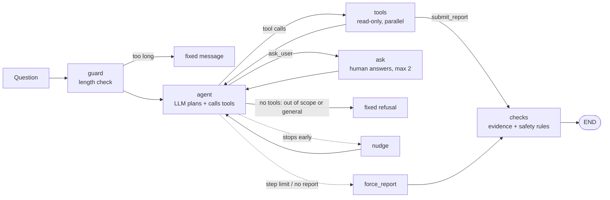

# Architecture

## The idea in one paragraph

The **LLM does the thinking**: it understands the question, decides which facts it needs, calls tools, asks the user at most twice and writes a report. **Code checks the result.** Every quote must really appear in what a tool returned. A few safety rules can only make a verdict stricter, and the decision label is computed from the report rather than written by the model. Code never prescribes the order of the agent's steps. This keeps the code small and lets the agent handle questions nobody anticipated, while the checks keep answers honest.

## Flow

A LangGraph `StateGraph` in [oss_agent/graph.py](oss_agent/graph.py) implements this flow. The human step (`ask`) uses `interrupt()`, and the graph resumes with the answer. Nothing is saved after a run: the report is the output.

### Example walk-through: "Is axios@1.14.1 safe to install in our production backend?"

1. **guard:** the question is under 2,000 characters, so it goes on to the agent.
2. **agent, step 1:** the agent picks out the package and version, then calls `get_repo_info` and `check_vulnerabilities` **in the same step**, since neither needs the other's result.
3. **tools:** both run. Their results are wrapped as `<untrusted_data>` before the model sees them.
4. **agent, step 2:** the agent calls `submit_report` with findings. Each finding has a quote and a link.
5. **checks:** code finds each quote in the tool output. If a vulnerability database flags the version as malicious, rule 1 sets security to red, whatever the model wrote.
6. **Decision:** 🔴 Do not adopt.

(This shows the path through the graph. Run with `--trace` to see the actual tool calls.)

## Limits that keep cost and loops bounded

| Limit | Value | Where |
|---|---|---|
| LLM steps per question | 10, then a minimal report is forced | `graph.MAX_STEPS` |
| Questions to the user | 2 | `graph.MAX_QUESTIONS` |
| Tools per step (Claude CLI backend) | 3 | `llm.MAX_ACTIONS` |
| Evidence feedback rounds | 1: the agent may fix its report once | `graph.py`, `evidence.gaps` |
| Invalid report retries | 1 | `graph.route_after_tools` |
| Tool result shown to the model | 4,000 chars | `graph.MAX_RESULT_CHARS` |
| Question length | 2,000 chars | `guard.MAX_QUESTION_CHARS` |
| HTTP | 15 s timeout, one retry, 2 MB cap | `http.py` |

## Tools (all read-only)

| Tool | Source | Returns |
|---|---|---|
| `get_repo_info` | GitHub API, package registries | licence (root and sub-folder licence files), activity, latest release, security policy, head commit. Takes a repo **or** a package, and the registry decides the repo (npm, Packagist, PyPI, crates.io, RubyGems; Go via the module path). |
| `check_vulnerabilities` | OSV, GitHub advisories, NVD, endoflife.date | advisories per version (the newest 10 per call; the rest are returned as not checked), malicious releases, end of life. Withdrawn advisories are ignored. One failing source never hides the others. |
| `find_version` | package registries, GitHub releases, endoflife.date | the version current at a date ("latest", `YYYY-MM-DD`, "N months ago", with the date computed by code), plus every newer version number. With `when` = a version and `until` = another: every released version in that range, from the source; a version that doesn't exist is an error |
| `search_code` | GitHub code search | matching files in the latest code (used for things like telemetry) |
| `read_file` | raw.githubusercontent.com | numbered lines at a commit or a release tag (`ref`); never silently falls back to the latest code |
| `ask_user` | the human | one clarifying question |
| `submit_report` | — | the agent's final report (JSON schema) |

## What code enforces

These are the only places where code overrides the model. Each one can only make an answer **stricter or more honest**, never more favourable.

| Check | File | Effect |
|---|---|---|
| Quote verification | `evidence.py` | A finding whose quote is not in any tool output is unverified. An area with no verified finding becomes "not checked". |
| Unsupported facts | `evidence.py` | A CVE, GHSA, MAL id or version number that no tool returned (and the user didn't write) is removed. The count is shown as a limitation. |
| Next steps need a source | `evidence.py`, `report.py` | Each "what to do next" item must name a finding. Code attaches that finding's link, and removes the step if the finding doesn't exist. |
| Rule 1: malware | `rules.safety` | A malicious release of the asked version makes security red, so the decision is Do not adopt. |
| Rule 2: no unverified approval | `rules.safety` | If no vulnerability database answered (an NVD search with 0 CVEs counts as "no match", not an answer), or the wrong package was checked, security is set to not checked, and the answer can never be Recommended. |
| Rule 4: versions not checked | `rules.safety`, `report._limitations` | The vulnerability check covers at most 10 versions per call (the newest). Any others come back as not checked. Code lists them by number as a limitation, security can't be green (so at best 🟡), and confidence drops from high to medium. |
| Rule 5: package not confirmed | `rules.safety`, `report._limitations` | The vulnerability check first asks the package's registry whether it exists. A name the registry doesn't know is an error ("nothing was checked"). If the registry gave no answer, or the ecosystem has no registry lookup (Maven, NuGet), security can't be green, a limitation says so, and confidence drops from high to medium. |
| Decision label | `report.decision` | Computed from area statuses, never written by the model. |
| Confidence | `report._confidence` | The model proposes a level. Code can only lower it. |
| Limitations | `report._limitations` | Lists only checks that failed: tool errors not redone, unavailable databases, removed claims. |
| Scope | `graph.agent`, `guard.py` | Out-of-scope and general questions get one fixed refusal from code (`guard.REFUSAL`). The model's own wording is never shown. |

## Security layers

| Layer | How |
|---|---|
| Read-only | `guard.READ_ONLY_TOOLS`; `build_graph()` asserts every data tool is in it |
| Network | `http.ALLOWED_HOSTS`: GitHub, OSV, NVD, endoflife.date and five package registries (listed in the README). Only GET, except POST to the one OSV query endpoint. |
| Prompt injection in fetched content | results are wrapped in `<untrusted_data>`; `guard.neutralise` stops text from closing the wrapper; `guard.scan_untrusted` flags instructions aimed at AI agents |
| Prompt injection in the question | wrapper and system tags are neutralised; role-change requests count as out of scope |
| Arguments | checked against the tool schema; length capped at 500 chars |
| Secrets | added in `http._auth_headers` at request time; not part of the cache key, so cached fixtures hold no secrets |
| Web UI | binds to 127.0.0.1 only; request bodies are not logged |

## Files

| File | Role |
|---|---|
| `prompts.py` | system prompt: scope, how to work (understand, plan, gather, answer), what each area needs, report format. General principles only, with no test cases. |
| `prompts_haiku.py` | the same prompt with stricter "when to stop" principles, for smaller models. `--haiku` on the CLI or server picks Haiku and this prompt; without it, Sonnet and `prompts.py`. `graph.build_graph` chooses the prompt from the model name (or `PROMPT=haiku`). |
| `graph.py` | the LangGraph state machine and routing |
| `llm.py` | three backends, all returning a LangChain `AIMessage` with tool calls: `ChatAnthropic` (API key), `ChatOpenAI` on OpenRouter (API key, any model with tool calling) and `ChatClaudeCLI` (`claude -p`, built-in tools disabled, JSON-schema replies) |
| `tools.py` | GitHub tools, the tool schemas, and the `submit_report` schema |
| `vulns.py` | OSV, GitHub advisories, NVD, endoflife.date |
| `versions.py` | `find_version` |
| `registries.py` | package registries: package → repo, versions with dates, does the package exist |
| `evidence.py` | quote verification, evidence gaps, feedback round, removal of unsupported claims |
| `rules.py` | the safety rules, legal references (GDPR/CRA articles for verified findings), overall status |
| `report.py` | post-processing pipeline, decision, confidence, limitations, `present()` for the web and `render()` for the CLI |
| `guard.py` | input checks, fixed messages, read-only list, injection scan |
| `http.py` | the only network access: allowlist, timeout, size cap, disk cache (also the offline fixture store) |
| `server.py`, `web/index.html` | standard-library HTTP server and single-page chat |
| `main.py` | command line |

## Report post-processing order

`report.post_process` runs these steps in order, with no LLM involved:

verify quotes → unbacked areas to not checked → strip unsupported claims and next steps → rules 1, 2, 4, 5 (safety) → rule 6 (privacy) → injection findings → legal references → overall status → confidence → checks run → limitations

## Design decisions

| Decision | Why | Trade-off |
|---|---|---|
| The LLM reads the question as written; code does no name normalisation | Code "fixing" typos made things worse. The model can understand a typo, while a look-alike package name is checked exactly as written. | It relies on model judgement, which the robustness eval measures |
| The model plans its tools; code never enforces an order | Handles unforeseen questions; less code | Tool choice can vary between runs |
| Independent tools in one step | fewer LLM round trips, so lower cost and latency | the CLI backend is capped at 3 per step |
| One fixed text for out-of-scope and general questions | no answers from memory, so nothing unverified | general questions get no answer |
| Code can only lower confidence and statuses | the model cannot talk its way to an approval | some answers are more cautious than they need to be |
| One evidence feedback round | the agent can repair a bad quote, and cost stays bounded | a second mistake is removed rather than fixed |
| A frozen HTTP snapshot for evals | a changed result means the agent changed, not the world | snapshots must be refreshed on purpose |
| No test-case terms in the prompt | prevents overfitting to the eval set | not checked automatically any more (the leak test was removed) |
| A separate prompt for smaller models, built from the main one | Haiku over-checked with the main prompt; the main prompt stays unchanged | two prompts to keep in step (the Haiku file fails at start-up if the passages it replaces change) |

## Known gaps

- Prompt caching works on OpenRouter (about 6–8k cached tokens per step in live runs); not measured on the Anthropic API backend.
- Big npm packages (e.g. n8n) exceed the 2 MB HTTP cap on the registry's full record, so `find_version` for them fails and falls back to other sources.
- No offline unit tests (removed on 25 Nov 2026): a code change is checked only by the evals, which call the model.
- The NVD CPE (vendor:product) and the endoflife.date id are chosen by the model from its own knowledge, not looked up in the source. A wrong id finds nothing, so code treats "0 CVEs" and a 404 as **no match**, never as a clean answer: for a product with no package ecosystem, security then shows as not checked. The cost: a product with genuinely zero CVEs also shows as not checked. The CPE used is shown in "checks run".
- `find_version` reads only the latest 100 GitHub releases.
- No registry lookup for Maven and NuGet yet: give the repository, and security can't be green.
- PyPI and RubyGems name a repository only if the author listed one; otherwise the agent must ask.
- `search_code` searches the latest code only, not a specific version.
- The evals have one run per case so far, which gives a first signal, not a pass rate.

## Package registries

The registry, not the model, says which repository a package comes from, which versions exist, and whether the package exists at all.

| Ecosystem | Registry | Package → repo | Versions with dates | Package exists |
|---|---|---|---|---|
| JavaScript | npm | ✅ | ✅ | ✅ |
| PHP | Packagist | ✅ | ✅ | ✅ |
| Python | PyPI | ✅ if the package lists its GitHub source | ✅ | ✅ |
| Rust | crates.io | ✅ | ✅ | ✅ |
| Ruby | RubyGems | ✅ if the gem lists its GitHub source | ✅ | ✅ |
| Go | none: the module path (`github.com/owner/name`) names the repo | ✅ | from GitHub releases | ✅ (the repo exists) |
| Java (Maven), .NET (NuGet) | **not yet** | ❌ give the repository instead | ❌ | ❌ |

Vulnerability databases (OSV, GitHub advisories) cover all of these ecosystems, Maven and NuGet included.

## External APIs

All calls are read-only (GET, plus one POST to the OSV query endpoint) and go through one function in `oss_agent/http.py`, which refuses every other host.

| Host | Used for | Key |
|---|---|---|
| api.github.com | repository facts, commits, licence, files, code search, releases, GitHub security advisories | `GITHUB_TOKEN`, optional |
| raw.githubusercontent.com | file contents at a pinned commit | — |
| api.osv.dev | vulnerabilities and malicious releases (OSV) | — |
| services.nvd.nist.gov | CVEs by CPE (NVD) | `NVD_API_KEY`, optional |
| endoflife.date | end-of-life dates of runtimes and products | — |
| registry.npmjs.org, repo.packagist.org, pypi.org, crates.io, rubygems.org | package registries | — |

## Running and settings

CLI options: `--haiku` (Haiku 5.5 and `prompts_haiku.py` instead of Sonnet 5.5), `--trace` (every step and tool call), `--json FILE` (full record), `--offline` (cached HTTP only), `--show-graph` (Mermaid), `--answer TEXT` (scripted answer to the agent's question). The web server takes `--haiku` too.

| Setting | Used by | Purpose |
|---|---|---|
| `LLM_MODEL` | `tests/eval.py` only | the CLI and server pick Sonnet, or Haiku with `--haiku`. With `openrouter` it is an OpenRouter id, e.g. `anthropic/claude-haiku-5.5` |
| `PROMPT=haiku` | all | forces the Haiku prompt for any model, e.g. to test Sonnet with it |
| `OSS_CACHE_DIR` | all | where HTTP responses are cached (default `tests/fixtures/http_cache`, not in git) |

The case eval checks per run: verdict, area statuses, required and forbidden tools, step and tool-call limits, questions asked, verified quotes, required finding, legal article and refusal.
