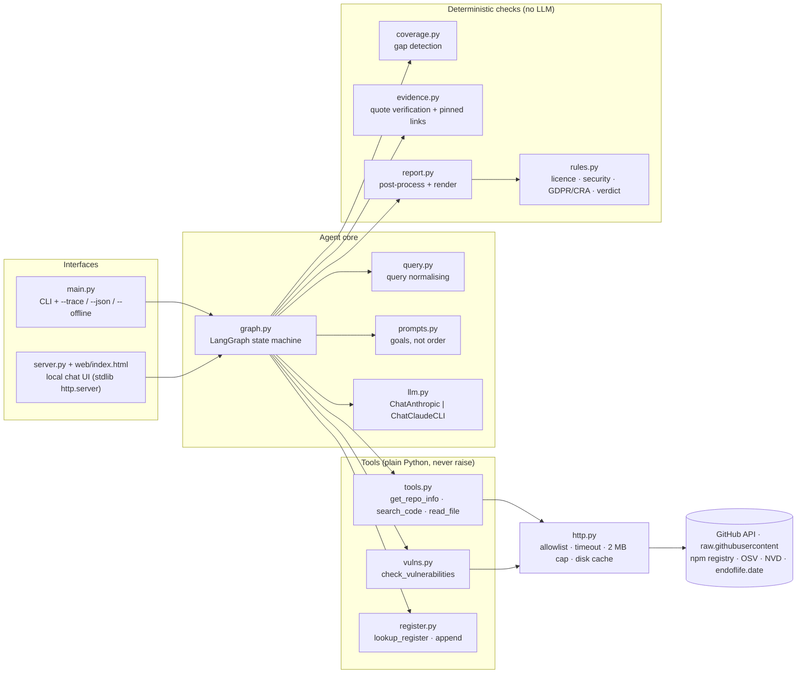
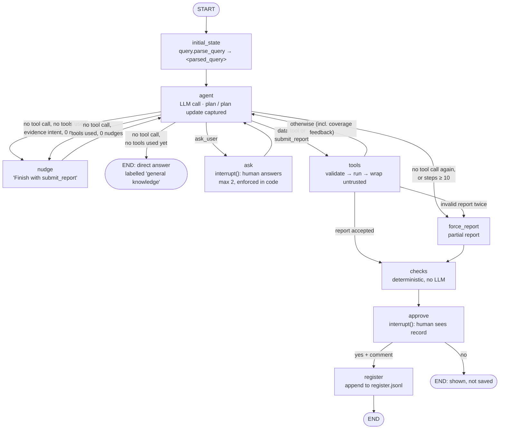
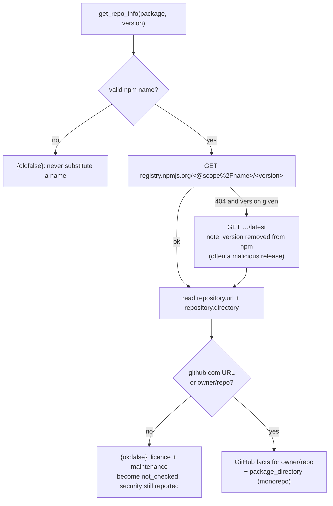
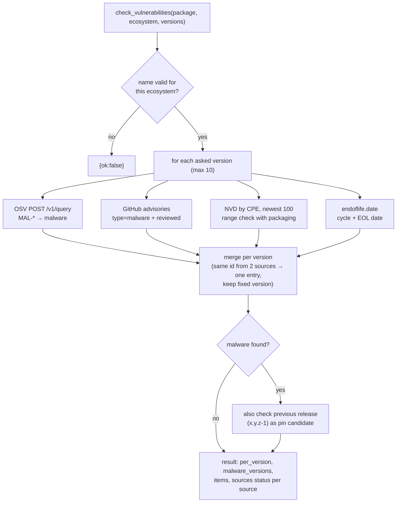
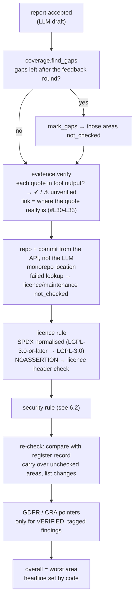
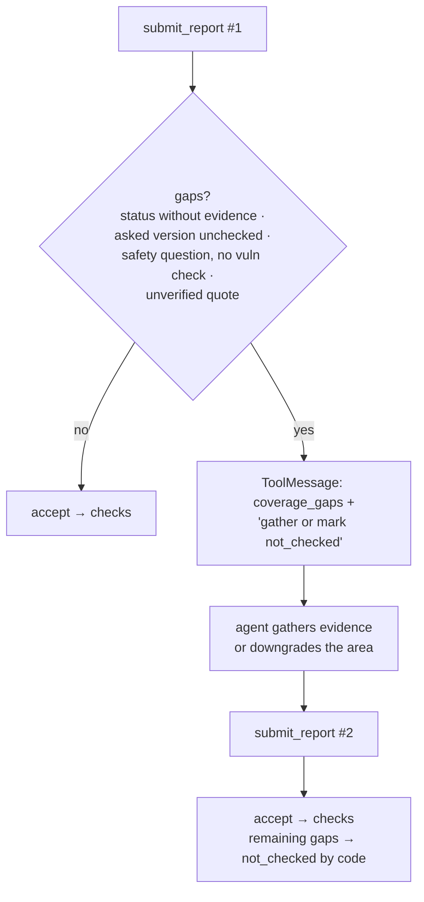
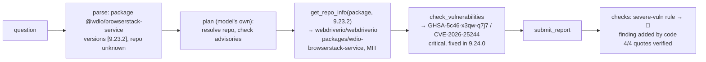

# OSS Due-Diligence Agent: Project Summary

*State as of 2026-11-21 · commit `4ca6d9a` · 68 unit tests passing · eval 21/27 (see section 9)*

## 1. What it does

A small, explainable AI agent that helps a **non-technical decision maker** decide whether an
open-source component (library, tool, or AI-agent skill) is safe to adopt. It checks five areas:

| Area | Question it answers |
|---|---|
| **Licence** | May we use it the way we plan to? |
| **Security** | Are there known vulnerabilities, malware releases, or end-of-life versions? |
| **Maintenance** | Is it still maintained, or archived? |
| **Privacy** | Does it send data out (telemetry) by default? |
| **Skills** | Does it ship AI-agent skill files that need review? |

The output is a short **due-diligence record**. Every finding has a quote that code has verified and a link to its source.
A human approves the record before it is saved to a register.

**Core design principle:** *the LLM plans and orders its own tool calls; deterministic code
checks the quality of the result.* Verdicts, headlines, quote verification, package identity
and legal pointers are decided by code, never by the LLM.

---

## 2. Architecture



### Modules

| File | Lines | Responsibility |
|---|---:|---|
| `graph.py` | 249 | LangGraph `StateGraph`: State, all nodes, routing, `run()` with interrupt/resume |
| `tools.py` | 388 | `get_repo_info` (incl. package → repo via npm registry), `search_code`, `read_file`, tool schemas, thin `StructuredTool` wrappers |
| `vulns.py` | 270 | `check_vulnerabilities`: OSV, GitHub advisories, NVD, endoflife.date, per version |
| `rules.py` | 217 | Licence table + SPDX normalisation, security rules, per-version verdicts, GDPR/CRA map, overall verdict |
| `llm.py` | 176 | `get_model()`: `ChatAnthropic` or `ChatClaudeCLI` (headless `claude -p`, locked down) |
| `report.py` | 163 | Validation, deterministic post-processing, terminal rendering |
| `http.py` | 124 | The only network gateway (allowlist, GET + OSV-only POST, cache = offline fixtures) |
| `evidence.py` | 108 | Quote verification, line-pinned links |
| `server.py` | 102 | Local web UI backend (`/api/start`, `/api/resume`) |
| `query.py` | 96 | Extracts exact packages, repos, versions and ranges from the question |
| `main.py` | 90 | CLI, scripted interrupt answers, trace printing |
| `prompts.py` | 63 | System prompt: goals, planning, facts to respect, evidence and security rules |
| `coverage.py` | 60 | Coverage gaps + the one-round feedback loop |
| `register.py` | 50 | `register.jsonl`: lookup of earlier approved records, append |
| **Python total** | **2,162** | plus `web/index.html` (288 lines, plain HTML/JS) |

**Dependencies:** `langgraph`, `langchain-anthropic`, `anthropic`, `requests`, `python-dotenv`, `packaging`, `pytest`.
LangGraph is used for the graph only. There are no prebuilt agents, no prebuilt `ToolNode`, and no chains: every node is our own function.

---

## 3. The agent graph (logic flow)



### State (what the graph remembers)

`question`, `parsed`, `messages`, `steps`, `tool_outputs` (full, untruncated, for verification),
`repo_info`, `report`, `report_retries`, `coverage_rounds`, `nudges`, `answer`, `questions_asked`,
`decision`, `trace`. A `MemorySaver` checkpointer keeps the state while the graph waits for a human.

### Limits enforced in code

| Limit | Value |
|---|---|
| LLM steps | `MAX_STEPS = 10`, then `force_report` |
| Tool calls per LLM step | 1 (`parallel_tool_calls=False`; CLI schema `maxItems: 1`) |
| Tool result sent to the LLM | 4,000 characters, wrapped in `<untrusted_data>` |
| Questions to the user | 2, then `"question limit reached, state an assumption"` |
| Invalid reports | 1 retry, then `force_report` |
| Coverage feedback | 1 round, then code marks gaps `not_checked` |
| Nudges | 1, then `force_report` |

---

## 4. One tool call, end to end

```mermaid
sequenceDiagram
    participant A as agent node
    participant M as LLM (Claude)
    participant T as tools node
    participant F as tool function
    participant H as http.py
    participant X as External API

    A->>M: system prompt + messages + tool schemas
    M-->>A: plan text + tool_call {name, args}
    Note over A: plan saved to trace
    A->>T: route_after_agent → tools
    T->>T: _validate_call(name, required args)
    alt unknown tool / missing args
        T-->>A: ToolMessage {ok:false, error}
    else valid
        T->>F: plain Python function(**args)
        F->>F: validate input (repo regex,<br/>per-ecosystem package names)
        F->>H: get(url) / post_json(osv)
        H->>H: allowlist · https only · cache hit?
        alt cached (or --offline)
            H-->>F: cached data
        else
            H->>X: GET/POST, 15 s timeout, 1 retry, 2 MB cap
            X-->>H: response
            H-->>F: data (written to cache)
        end
        F-->>T: {ok:true, ...} or {ok:false, error}  (never raises)
        T->>T: store FULL result in tool_outputs
        T-->>A: ToolMessage: truncate 4,000 chars,<br/>wrap in &lt;untrusted_data&gt;
    end
```

### The tools

Every tool description follows the same shape, **NEEDS / RETURNS / GOOD FOR**, and never states an order.

| Tool | Needs | Returns | Sources |
|---|---|---|---|
| `get_repo_info` | repo **or** package (+ ecosystem, version) | archived flag, HEAD SHA/date, stars, licence SPDX + first 60 lines, SECURITY.md (repo or org-wide), SKILL.md paths, monorepo folder | npm registry, GitHub API, raw.githubusercontent |
| `check_vulnerabilities` | package (+ ecosystem, versions). **No repo** | per version: malware, vulnerabilities, end-of-life; which sources answered | OSV, GitHub advisories, NVD, endoflife.date |
| `search_code` | repo + query | up to 10 files with fragments | GitHub code search |
| `read_file` | repo + path (+ lines) | numbered lines at HEAD with pinned link | raw.githubusercontent |
| `lookup_register` | repo | latest earlier approved record, or `found: false` | local `register.jsonl` |
| `ask_user` | one question | user's answer or `UNKNOWN` | human (interrupt) |
| `submit_report` | the record | (validated + coverage-checked) | n/a |

### Package → repo resolution (inside `get_repo_info`)



*Why the asked version matters:* `@wdio/browserstack-service@latest` points to `browserstack/…`,
while version 9.23.2 lives in `webdriverio/webdriverio/packages/wdio-browserstack-service`.
The repo is **never** derived from the npm scope.

### Inside `check_vulnerabilities`



One failing source never hides the others. Each source reports `ok`, `skipped: …` or `unavailable: …`,
so code can tell "nothing found" apart from "could not check".

---

## 5. The `checks` node: code decides



### Coverage feedback loop



---

## 6. Deterministic rules (code, never the LLM)

### 6.1 Licence
| SPDX (normalised) | Status |
|---|---|
| MIT, Apache-2.0, BSD-*, ISC | green |
| LGPL, MPL, EPL (weak copyleft) | green + note |
| GPL (strong copyleft) | yellow |
| AGPL (network copyleft) | yellow |
| No licence file | red ("no licence = no permission") |
| NOASSERTION / custom | LLM reads the file (unless a standard header is recognised) |

### 6.2 Security (applied over all `check_vulnerabilities` results)
| Condition | Result |
|---|---|
| Check failed, no source answered, or **wrong package checked** | security `not_checked`, headline **"Security could not be verified"** (overrides an LLM "green") |
| Malware in **any** asked version | red, headline **"Do not use: malicious release"**, code-written recommendation, code-added finding |
| End-of-life version | red, "upgrade to newest supported cycle" |
| Critical/high vulnerability in an asked version | red, ids (GHSA/CVE) + fixed version, code-added finding |
| Malware exists but no version asked | yellow, names the bad releases |

**Per-version lines:** malware/EOL/severe → 🔴, other vulnerabilities → 🟡,
"no advisory next to a malicious release" → 🟡 *not proven clean*, else 🟢.

### 6.3 Other rules
- **Archived repo** → maintenance red.
- **Overall** = worst area.
- **GDPR Art. 25/28/35/44** come from fact tags on *verified* findings only. Any security issue adds **CRA Art. 13(5)**.
- The agent never says "compliant".

---

## 7. Guardrails and security

| Risk | Guardrail |
|---|---|
| LLM invents facts | Every quote is verified against this run's tool output; links are chosen by code |
| LLM "corrects" a package name | Per-ecosystem name rules; the exact name is checked; a wrong-package check → "could not be verified" |
| LLM guesses a repo | Repo comes from registry metadata or the user, never from a scope; `<parsed_query>` gives exact names |
| Prompt injection in the question | `guard` node runs **before any LLM call** and refuses injection patterns and oversized input (0 tokens spent) |
| Prompt injection in READMEs / SKILL.md | Wrapped in `<untrusted_data>`; code stops content from closing or faking the wrapper; code flags instruction-like text as a finding; the web UI renders with `textContent` only |
| Off-topic questions | Model must reply `OUT_OF_SCOPE` → code's fixed refusal; a question with no scope signal answered without tools → refused by code |
| Write or execute actions | `READ_ONLY_TOOLS`, asserted at start-up; the tools node rejects anything else; arguments capped at 500 characters |
| Network abuse | Allowlist of 6 hosts, https only, POST only to the exact OSV query URL, 15 s timeout, 2 MB cap |
| Executing untrusted code | Never clones, installs or runs anything; `ChatClaudeCLI` runs with all built-in tools disabled |
| Secrets | Tokens added at request time, never cached, logged or passed to the CLI |
| Unapproved records | Nothing is saved without an explicit "yes"; Ctrl+C saves nothing |

---

## 8. Example walk-through

**Question:** *"We use @wdio/browserstack-service 9.23.2 with BrowserStack smart selection in our CI pipeline. Is it safe?"*



Result: **🔴**, "Package lives in webdriverio/webdriverio/packages/wdio-browserstack-service",
"9.23.2: critical vulnerability … fixed in 9.24.0". This took 2 tool calls, 0 questions and about 28 s.

---

## 9. How to run

```bash
.venv/bin/python -m oss_agent "Can we use pallets/flask in a commercial product?" --trace
.venv/bin/python -m oss_agent --show-graph            # Mermaid graph
.venv/bin/python -m oss_agent.server                  # chat UI on http://127.0.0.1:8000
.venv/bin/python -m pytest -q                         # 68 offline unit tests
.venv/bin/python tests/eval.py --record               # once online: record fixtures
.venv/bin/python tests/eval.py --runs 3               # offline eval, 3 runs per case
```

## 10. Evaluation status

Last full run: **21/27 runs passed (77%)**, about 29.6K tokens and 26.5 s per run on average. Plan diversity
passes (max word overlap between plans 0.23, limit 0.7).

| Case | Result | Note |
|---|---|---|
| flask-commercial | 3/3 | 1 tool call each time |
| php-81-eol | 3/3 | |
| mit-vs-gpl-no-tools | 3/3 | 0 tools |
| nonexistent-repo | 3/3 | |
| archived-repo | 3/3 | |
| wppconnect-malware-range | 3/3 | regression case |
| wdio-browserstack-cve | 2/3 | 1 failure was the CLI usage limit, not the agent |
| axios-new-app | 1/3 | **real gap:** model skipped `check_vulnerabilities` and said green |
| n8n-selfhost-customer-data | 0/3 | **under investigation:** privacy ended `not_checked` |
| malicious-skill | pending | needs `scan_skill` |

## 11. Known limitations and next steps

1. ~~Answers that used no tools aren't labelled.~~ **Fixed:** code labels them "Answered from general knowledge"; questions about component risks get one evidence reminder; eval case `langchain-vs-langgraph-risks`.
2. ~~Security left unchecked isn't treated as a gap for "can we add X?"~~ **Fixed:** a `required` coverage gap, then the headline "Security not checked: not an approval to use".
3. ~~n8n eval 0/3~~ **Explained:** an eval-setup problem (free-form search words aren't in offline fixtures). Misses are now labelled `MISS` and not scored; that case runs with live HTTP.
4. **Package → repo lookup is npm-only.** PyPI (`project_urls`) is next. Without it, a question that names no language may get checked for the JavaScript packages.
5. **Default LLM provider** is still `claude_cli` (dev). The submission default should be `anthropic`.
6. **`scan_skill`** and the malicious-skill fixture (M4b) are not built yet.
7. **Code size** is 2,162 Python lines, against the original ~800 target. A simplification pass is due.
